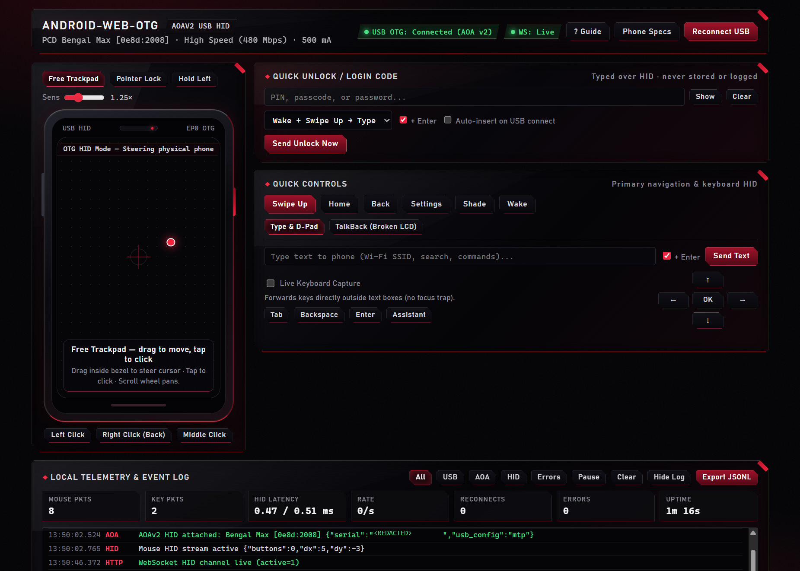
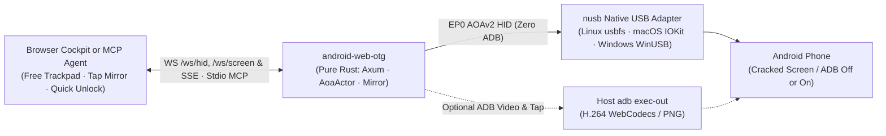
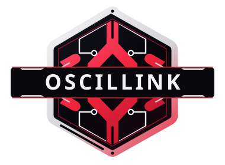

<div align="center">
  
  <h1>android-web-otg</h1>
  <p><sub><strong>by Oscillink</strong></sub></p>
  <p>
    <strong>Recover and steer any broken-screen Android phone from your browser over USB OTG (<code>AOAv2 HID</code>)</strong><br />
    Pure Rust for <strong>Linux, macOS, and Windows</strong> — works before USB Debugging (<code>adb</code>) is enabled, plus optional live Screen Mirroring and a built-in stdio MCP server once ADB is on.
  </p>
  <p>
    <a href="https://github.com/Maverick0351a/android-web-otg/actions/workflows/ci.yml"></a>
    <a href="https://github.com/Maverick0351a/android-web-otg/releases"></a>
    <a href="Cargo.toml"></a>
    <a href="LICENSE"></a>
  </p>
  <p>
    <a href="#demo--screenshots">Demo</a> &middot;
    <a href="#how-it-works">How It Works</a> &middot;
    <a href="#platform-support--usb-permissions">Platform Support</a> &middot;
    <a href="#quickstart">Quickstart</a> &middot;
    <a href="#screen-mirroring--ai-agents-mcp">Mirroring &amp; MCP</a> &middot;
    <a href="#deployment-templates">Docker &amp; Systemd</a> &middot;
    <a href="#security-architecture">Security</a>
  </p>
</div>

---

> [!IMPORTANT]
> **No video feed while USB Debugging is off:** Android does not expose screen pixels over USB before ADB is authorized. When `adb` is disabled, `android-web-otg` gives you **physical USB mouse, keyboard, TalkBack shortcuts, and hardware USB inspection** over **EP0 AOAv2 HID** so you can unlock the phone and turn on USB Debugging. Once ADB is authorized, click **Mirror Screen** in the cockpit to stream live video (**H.264 WebCodecs** or **PNG**) inside the phone bezel with calibrated **Tap Mirror** clicks and swipes.

## Demo & Screenshots

<p align="center">
  
</p>

| Cockpit Dashboard (Volcanic Obsidian UI) | USB &amp; AOAv2 Hardware Specs Modal |
|---|---|
|  |  |

- **Calm, popup-free controls:** **Free Trackpad** is active by default so dragging and tapping never trigger browser Pointer Lock banners unless you choose **Pointer Lock** (`Esc` releases). **? Guide** expands inline below the header, and actions confirm in place without floating toast overlays.
- **Pre-ADB inspection:** Click **Phone Specs** at any time to read USB `VID:PID`, AOAv2 protocol version, negotiated link speed, `bMaxPower`, bus/address, and active interface descriptors directly over USB.

## Why `android-web-otg`?

| Capability | Details |
|---|---|
| **Pre-ADB Broken-Screen Rescue** | Uses Android Open Accessory v2 (`EP0` requests `51`, `54`, `55`, `56`, `57`) so hardware mouse and keyboard work before USB Debugging is enabled — leaving MTP and `adb` interfaces untouched. |
| **Native USB Adapter via `nusb`** | Pure-Rust async [`nusb`](https://crates.io/crates/nusb) (`features = ["tokio"]`) talks directly to **Linux `usbfs`**, **macOS `IOKit`**, and **Windows `WinUSB`** with zero `libusb` or Python/Node runtime. |
| **Built-In Live Screen Mirror** | Optional pure-Rust mirror (`src/mirror.rs`) uses host `adb exec-out` with **WebCodecs H.264** (`screenrecord`), instant first-frame & automatic **PNG** fallback (`screencap`), and letterbox-accurate **Tap Mirror** clicks & swipes right inside the phone bezel. |
| **Built-In Stdio MCP & Skill** | Launch `android-web-otg --mcp` to give **Antigravity, Claude Code, Cursor, Codex, or Gemini CLI** 9 structured tools (`otg_status`, `otg_mouse`, `otg_screen_capture`, `otg_tap`, etc.), paired with [`skills/android-web-otg/SKILL.md`](skills/android-web-otg/SKILL.md). |
| **Resilient `f_accessory` Timing** | Waits `200 ms` after registering HID report descriptors for Android's kernel `hid_add_device()` workqueue and retries transient `Stall` frames cleanly without unregistering HID IDs. |
| **Zero-Storage Secret Isolation** | Quick Unlock PINs/passcodes and `ANDROID_WEB_OTG_UNLOCK_CODE` are ASCII-validated, zeroized in memory (`zeroize`), never logged or saved in `localStorage`, and never exposed to MCP tools. |
| **Local Telemetry & JSONL Export** | Lock-free `AtomicU64` packet/reconnect/error counters, `avg / last / max` HID round-trip latency in the UI, Server-Sent Events (`/api/telemetry/stream` with `Last-Event-ID`), and 1-click JSONL export. |

## How It Works



## Platform Support & USB Permissions

| Host OS | Binary Support | Driver / Setup Notes |
|---|---|---|
| **Linux** (Desktop, Laptop, Raspberry Pi, Headless Server) | **Native (`x86_64`, `aarch64`)** — uses kernel `usbfs` directly | Install [`deploy/51-android.rules`](deploy/51-android.rules) (`MODE="0660", GROUP="plugdev", TAG+="uaccess"`, 29 OEM VIDs + `ID_MTP_DEVICE`), reload udev, join `plugdev`, and replug USB. If using our **non-root Docker container** (`USER otg`), you still need `51-android.rules` on the host. |
| **macOS** (`Apple Silicon` & `Intel`) | **Native (`aarch64`, `x86_64`)** — uses Apple `IOKit` directly | Close exclusive MTP/PTP helpers (*Android File Transfer*, *OpenMTP*, Image Capture / `ptpcamera`) if the device reports busy. Clear Gatekeeper quarantine once on downloaded binaries (`xattr -d com.apple.quarantine`). *(Physical hardware verification so far is Linux-tested; macOS IOKit builds and passes unit/integration CI tests.)* |
| **Windows 10/11** (`x86_64`) | **Native `.exe`** *(or WSL2)* — uses Microsoft `WinUSB` | **Important when ADB is OFF:** almost every Android phone defaults to MTP (`0x06`, claimed by inbox `WUDFWpdMtp`), which blocks raw EP0 transfers. Nearly all ADB-off Windows users will bind **WinUSB once via Zadig** (same Windows limitation as `scrcpy --otg`) **or** attach USB into **WSL2** with `usbipd-win`. |

## Quickstart

### 1. Download Prebuilt Binary (Recommended)

Grab the archive for your OS from the [**latest GitHub Release**](https://github.com/Maverick0351a/android-web-otg/releases/latest) (`x86_64` / `aarch64` Linux, `aarch64` / `x86_64` macOS, or `x86_64` Windows `.zip`, each paired with `SHA256SUMS-*.txt`).

#### macOS

```bash
tar -xzf android-web-otg-v*-apple-darwin.tar.gz
xattr -d com.apple.quarantine ./android-web-otg
./android-web-otg
```

Open **`http://127.0.0.1:8095`** in Safari or Chrome. Close *Android File Transfer* / *OpenMTP* (or kill `ptpcamera` if Image Capture grabs the device).

#### Windows 10/11

1. Extract `android-web-otg.exe` from the release `.zip`.
2. **If your phone has ADB off / reports USB access denied (`WUDFWpdMtp`):**
   - Download [**Zadig**](https://zadig.akeo.ie/), open **Options → List All Devices**, select your Android device (composite parent or MTP/ADB interface), choose **WinUSB**, and click **Replace Driver**.
   - *(Reverting later takes 10 seconds in **Device Manager** → right-click device → **Uninstall device** → check **Attempt to remove the driver** → replug USB to restore Windows Explorer MTP.)*
3. Run the bridge in PowerShell and open **`http://127.0.0.1:8095`**:
   ```powershell
   .\android-web-otg.exe
   ```

<details>
<summary>Optional Windows zero-Zadig setup using WSL2 + usbipd-win</summary>

1. Install `usbipd-win` once in an elevated PowerShell prompt:
   ```powershell
   winget install usbipd
   ```
2. Find and attach your Android phone's `<BUSID>` to WSL2:
   ```powershell
   usbipd list
   usbipd bind --busid <BUSID>
   usbipd attach --wsl --busid <BUSID>
   ```
3. Inside **WSL2 Ubuntu/Debian**, use the **Linux** `.tar.gz` release binary (or `cargo build --release` inside WSL2 — not the Windows `.exe`), install [`deploy/51-android.rules`](deploy/51-android.rules) (ensure `systemd=true` is enabled in `/etc/wsl.conf` so `systemd-udevd` runs, or fix permissions / run `plugdev` reload), and run:
   ```bash
   ./android-web-otg
   ```
   Then open **`http://127.0.0.1:8095`** in your Windows browser.

</details>

#### Linux (Desktop, Laptop, Raspberry Pi, or Headless Server)

```bash
tar -xzf android-web-otg-v*-linux-gnu.tar.gz
sudo cp deploy/51-android.rules /etc/udev/rules.d/
sudo udevadm control --reload-rules && sudo udevadm trigger

# Non-Debian distros (Fedora, Arch, RHEL) may need: sudo groupadd -f plugdev
sudo usermod -aG plugdev "$USER"
# Log out and back in (or run `newgrp plugdev`), and unplug + replug the USB data cable

./android-web-otg
```

Open **`http://127.0.0.1:8095`** in your browser.

### 2. Build from Source

Prerequisites: [Rust 1.85+](https://rustup.rs/) (`rustup`), `git`, and your OS C/linker toolchain (**Windows:** Visual Studio C++ Build Tools; **macOS:** `xcode-select --install`; **Linux:** `build-essential` / `gcc`).

```bash
git clone https://github.com/Maverick0351a/android-web-otg.git
cd android-web-otg
cargo build --release --locked
./target/release/android-web-otg
```

> [!TIP]
> **Dead or pitch-black LCD?** Hold **Volume Up + Volume Down** on the phone for ~3 seconds to toggle Android **TalkBack**, then switch to the **TalkBack (Broken LCD)** tab in **Quick Controls** (`Alt+←`, `Alt+→`, `Alt+Enter`) to navigate by spoken feedback and turn on **Developer Options → USB debugging**.

## Screen Mirroring & AI Agents (`--mcp`)

### Live Screen Mirroring (Once USB Debugging Is Enabled)

1. Use **Free Trackpad** / **Quick Unlock** / **TalkBack** to enable **USB debugging** on the phone (`Settings → Developer options`), and accept the **"Allow USB debugging?"** RSA prompt (`Tab → Tab → Enter` or mouse click).
2. Ensure [`adb`](https://developer.android.com/tools/releases/platform-tools) is on your `PATH` (or pass `--adb-path /path/to/adb`). The header pill switches to **`Mirror: Ready`**.
3. Click **Mirror Screen** above the phone chassis:
   - **`Auto (H.264 / PNG)`** captures an instant PNG frame first, streams low-latency `screenrecord` Annex-B **H.264** into your browser's `VideoDecoder`, and automatically falls back to **PNG** on plain HTTP LAN/Tailscale or unsupported decoders.
   - Switch between **Free Trackpad** (steer hardware USB pointer over live video) and **Tap Mirror** (direct letterbox-calibrated pixel taps and drag swipes via ADB).

### Built-In Stdio MCP Server (`android-web-otg --mcp`)

Add `android-web-otg` directly to **Antigravity, Claude Code, Cursor, Codex, or Gemini CLI** — zero Python or Node wrapper needed:

```json
{
  "mcpServers": {
    "android-web-otg": {
      "command": "android-web-otg",
      "args": ["--mcp"],
      "env": {
        "ANDROID_WEB_OTG_ADB": "adb"
      }
    }
  }
}
```

And copy [`skills/android-web-otg/SKILL.md`](skills/android-web-otg/SKILL.md) into your agent's skills folder so agents automatically follow the two-phase **Pre-ADB Rescue → Post-ADB Visual** workflow and never request phone PINs in chat logs.

| MCP Tool | Phase | Purpose |
|---|---|---|
| `otg_status` / `otg_specs` | Pre & Post ADB | Inspect live USB AOAv2 state, ADB mirror state, resolution, and hardware descriptors |
| `otg_mouse` / `otg_swipe_up` / `otg_key` / `otg_text` | Pre-ADB (AOAv2 HID) | Wake phone, steer mouse, trigger TalkBack / Home / Back, accept ADB RSA dialog, type non-secret text |
| `otg_screen_capture` / `otg_tap` / `otg_swipe` | Post-ADB | Return inline Base64 PNG frame to vision agents and send exact pixel taps or swipes |

## Common CLI Flags

By default `android-web-otg` binds to `--host 127.0.0.1 --port 8095`.

**macOS / Linux (bash/zsh):**

```bash
# Bind to a private VPN/Tailscale or LAN IP (token is REQUIRED when non-loopback; open TCP 8095 in firewall)
export ANDROID_WEB_OTG_TOKEN="replace-with-strong-random-token"
android-web-otg --host <tailscale-or-lan-ip> --port 8095

# Pin by USB serial or VID/PID, ignore an unrelated USB device, set custom adb, and save JSONL telemetry
android-web-otg --vid 0e8d --pid 2008 --serial ABC123456 --ignore-vid 148f --adb-path /usr/bin/adb --log-file ./otg-telemetry.jsonl

# Single-shot auto-insert of unlock PIN/password once per newly attached phone
export ANDROID_WEB_OTG_UNLOCK_CODE="1234"
android-web-otg --auto-unlock --unlock-wake swipe
```

**Windows (PowerShell):**

```powershell
$env:ANDROID_WEB_OTG_TOKEN = "replace-with-strong-random-token"
.\android-web-otg.exe --host <tailscale-or-lan-ip> --port 8095

$env:ANDROID_WEB_OTG_UNLOCK_CODE = "1234"
.\android-web-otg.exe --auto-unlock --unlock-wake swipe
```

## Hardware Verification

Verified live (Linux Docker host + pure-Rust `v0.1` core) against a physical broken-screen Android phone (**`PCD Bengal Max`**, USB `0e8d:2008`, MediaTek, High Speed 480 Mbps, 500 mA) running inside an unprivileged non-root container (`--cap-drop=ALL`, `USER otg`):

- **AOAv2 HID attach:** Attached cleanly in `mtp` configuration (`AOA v2`) without claiming MTP or requiring `adb`.
- **Physical screen wakeup & HID response:** Verified directly on hardware that the broken phone's display lit up and responded live to WebSocket HID cursor movements and left clicks at **`0.42–0.60 ms` EP0 round-trip latency** with zero stalled transfers.
- **Clean shutdown:** `SIGINT` / `SIGTERM` unregisters both virtual HID devices (`hid=1` mouse, `hid=2` keyboard) cleanly (~`0.12s` stop time).

## Deployment Templates

<details>
<summary><strong>Linux udev rules, systemd service, and least-privilege non-root Docker commands</strong></summary>

- **`udev` rules (`0660`, `plugdev`, `uaccess`):** [`deploy/51-android.rules`](deploy/51-android.rules)
- **Hardened `systemd` service:** [`deploy/android-web-otg.service`](deploy/android-web-otg.service)
  - Requires creating the service user and installing the binary:
    ```bash
    sudo groupadd -f plugdev
    sudo useradd -r -g plugdev -s /sbin/nologin otg
    sudo install -m 0755 android-web-otg /usr/local/bin/android-web-otg
    sudo install -m 0600 /dev/null /etc/android-web-otg.env   # add ANDROID_WEB_OTG_TOKEN / ANDROID_WEB_OTG_UNLOCK_CODE
    sudo cp deploy/android-web-otg.service /etc/systemd/system/
    sudo systemctl daemon-reload && sudo systemctl enable --now android-web-otg
    ```
  - `ANDROID_WEB_OTG_UNLOCK_CODE` enables the UI **"Unlock with Server Preset"** button; add `--auto-unlock` to `ExecStart` to auto-type on USB attach.
- **Least-privilege non-root Docker container (`debian:bookworm-slim`, `USER otg`, zero `--privileged`):**
  > Install [`deploy/51-android.rules`](deploy/51-android.rules) on the Linux host first so `/dev/bus/usb/*/*` grants `0660 plugdev` write access.
  ```bash
  docker build -t android-web-otg -f deploy/Dockerfile .

  PLUGDEV_GID="$(getent group plugdev | cut -d: -f3 || true)"

  # Default container entrypoint listens on 0.0.0.0:8095 and fails closed without ANDROID_WEB_OTG_TOKEN:
  docker run --rm --network host \
    --cap-drop=ALL \
    --device-cgroup-rule='c 189:* rmw' \
    -v /dev/bus/usb:/dev/bus/usb \
    ${PLUGDEV_GID:+--group-add "$PLUGDEV_GID"} \
    -e ANDROID_WEB_OTG_TOKEN="replace-with-strong-random-token" \
    android-web-otg

  # Or override entrypoint for loopback-only testing without --token:
  docker run --rm --network host \
    --cap-drop=ALL \
    --device-cgroup-rule='c 189:* rmw' \
    -v /dev/bus/usb:/dev/bus/usb \
    ${PLUGDEV_GID:+--group-add "$PLUGDEV_GID"} \
    --entrypoint /usr/local/bin/android-web-otg \
    android-web-otg --host 127.0.0.1 --port 8095
  ```

</details>

## Security Architecture

> [!CAUTION]
> Because `android-web-otg` injects real physical keyboard and mouse HID events into any matched Android device over USB, **never expose it on an untrusted LAN or the public internet without a strong `--token` and firewall/VPN isolation**.

- **Fail-closed non-loopback binds:** Starting HTTP mode on any non-loopback `--host` (such as `0.0.0.0`, `::`, or a LAN/VPN IP) without a non-empty `--token` / `ANDROID_WEB_OTG_TOKEN` **exits immediately with status code `2`** before touching USB (`validate_bind_auth` in `src/server.rs`).
- **Session cookie & header auth:** `POST /api/auth` validates the token using constant-time comparison (`subtle`) and issues an `HttpOnly; SameSite=Strict` CSPRNG session cookie. Query-string `?token=` URL parameters are rejected to keep credentials out of browser history and logs.
- **DNS rebinding & CSWSH defense:** On loopback binds (`127.0.0.0/8`, `localhost`, `::1`), `/api/*` and `/ws/*` enforce a strict `Host` allowlist (`allowed_hosts_for_bind`). When `Origin` or `Sec-Fetch-Site` headers are present they are verified as same-origin, and WebSocket upgrades on both `/ws/hid` and `/ws/screen` strictly require a matching `Origin` header.
- **Secret isolation:** Manual unlock codes and `ANDROID_WEB_OTG_UNLOCK_CODE` are ASCII-validated, normalized, wrapped in `Zeroizing`, excluded from `localStorage`, JSON responses, telemetry logs, and omitted from MCP tool schemas.

## Troubleshooting & Limitations

<details>
<summary><strong>Common issues, USB cables, keyboard layout, and vs. scrcpy</strong></summary>

- **Phone not detected (`No Android USB device detected`):** Check your USB cable first — **charge-only cables lack `D+/D-` data pins**. Swap to a known data cable or direct motherboard port.
- **Text or PIN characters mistyped:** HID scancodes in `src/hid.rs` use the **US QWERTY** layout and accept ASCII printable characters only. Switch Android's on-device physical keyboard layout to English (US) if punctuation/letters remap.
- **Before First Unlock (BFU) / OEM AOAv2 blocks:** Android requires hardware PIN entry on a cold reboot before unlocking credential-encrypted storage; some devices restrict USB accessories at BFU (`USB Restricted Mode`) or disable `CONFIG_USB_F_ACCESSORY` in custom kernels.
- **macOS exclusive access / Gatekeeper:** If `android-web-otg` says `"cannot be opened because the developer cannot be verified"`, run `xattr -d com.apple.quarantine ./android-web-otg`. If `IOKit` reports busy, quit *Android File Transfer* / *OpenMTP* / *Image Capture*.
- **Revert Windows Zadig WinUSB back to MTP:** Open **Device Manager → Universal Serial Bus devices** → right-click the phone → **Uninstall device** → check **Attempt to remove the driver** → replug USB.
- **How this differs from `scrcpy --otg`:** `scrcpy --otg` is a great native desktop SDL window; `android-web-otg` serves a browser cockpit (trackpad, Quick Unlock, TalkBack macros, USB descriptor inspector, JSONL telemetry, LAN/Tailscale remote rescue) **plus** optional WebCodecs/PNG mirroring and a native stdio MCP server (`--mcp`) with zero `libusb`, `SDL`, or `FFmpeg` dependencies.

</details>

## Roadmap

Multi-device switching, custom clean-room server APK/DEX telemetry (live Accessibility UI tree, battery/thermal/storage stats, 1-click backup), macro recording/replay, and native **Antigravity MCP App** side-pane packaging live in a companion **Oscillink Pro / Android USB Workbench** effort so `android-web-otg` remains a lean, focused, MIT-licensed rescue utility.

---

<div align="center">
  
  <p>Built by <strong>Oscillink</strong> &middot; <a href="LICENSE">MIT License</a></p>
</div>
