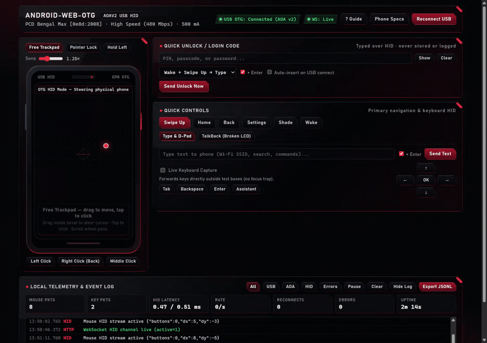
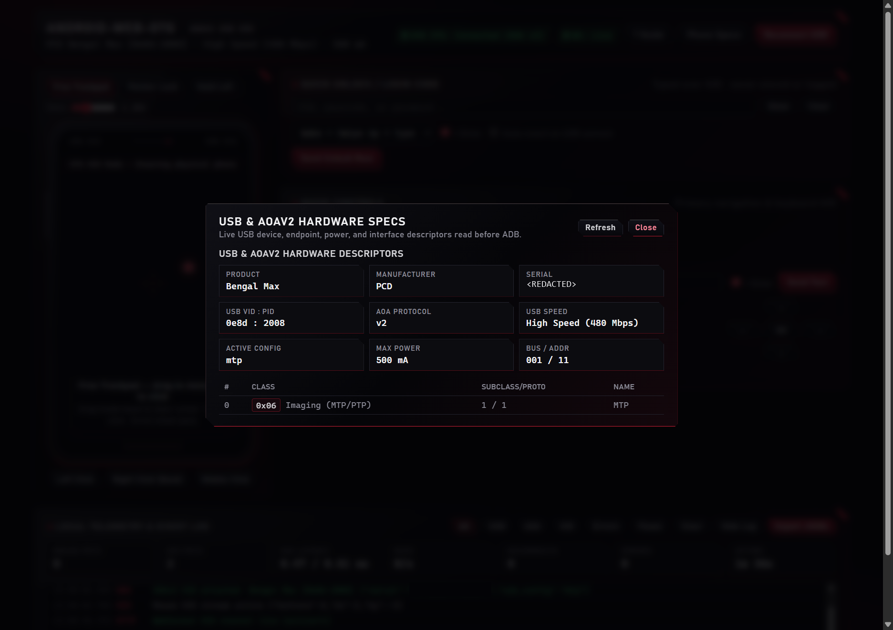
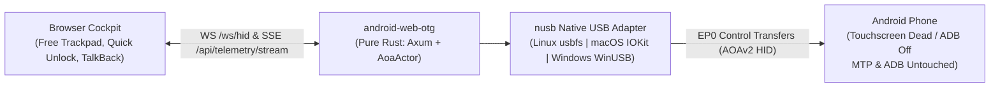

<div align="center">
  
  <h1>android-web-otg</h1>
  <p><sub><strong>by Oscillink</strong></sub></p>
  <p>
    <strong>Steer any broken-screen Android phone from your browser over USB OTG (<code>AOAv2 HID</code>)</strong><br />
    Pure Rust for <strong>Linux, macOS, and Windows</strong> — zero <code>adb</code>, zero <code>libusb</code>, and <strong>no separate Linux box required</strong>.
  </p>
  <p>
    <a href="https://github.com/Maverick0351a/android-web-otg/actions/workflows/ci.yml"></a>
    <a href="Cargo.toml"></a>
    <a href="LICENSE"></a>
    
    
    
  </p>
  <p>
    <a href="#demo--screenshots">Demo</a> &middot;
    <a href="#platform-support--usb-permissions">Platform Support</a> &middot;
    <a href="#quickstart">Quickstart</a> &middot;
    <a href="#how-it-works">How It Works</a> &middot;
    <a href="#deployment-templates">Docker &amp; Systemd</a> &middot;
    <a href="#security-architecture">Security</a>
  </p>
</div>

---

Plug a phone with a cracked or unresponsive touchscreen straight into your **Mac, Windows PC, Linux laptop, or Raspberry Pi**, open `http://127.0.0.1:8095`, and inject hardware mouse and keyboard input over **EP0 AOAv2 USB HID** — **even when USB Debugging (`adb`) is turned OFF**.

## Demo & Screenshots

<p align="center">
  
</p>

| Cockpit Dashboard (Volcanic Obsidian UI) | USB &amp; AOAv2 Hardware Specs Modal |
|---|---|
|  |  |

- **Calm, popup-free controls:** **Free Trackpad** is active by default so dragging and tapping never trigger browser Pointer Lock banners unless you switch to **Pointer Lock** (`Esc` releases). **? Guide** expands cleanly inline below the header, and actions confirm in place without toast overlays.
- **Pre-ADB inspection:** Click **Phone Specs** at any time to read USB `VID:PID`, AOAv2 protocol version, negotiated link speed, `bMaxPower`, bus/address, and active interface descriptors directly over USB.

## Why android-web-otg?

| Capability | Details |
|---|---|
| **Pre-ADB Broken-Screen Rescue** | Uses Android Open Accessory v2 (`EP0` requests `51`, `54`, `55`, `56`, `57`) so mouse and keyboard work before USB Debugging is enabled — leaving MTP and `adb` interfaces untouched. |
| **Runs Locally on Any OS** | Launch it directly on your **macOS, Windows, or Linux** machine (`http://127.0.0.1:8095`). No separate Linux host required — and ideal for headless USB benches or Raspberry Pi too. |
| **Native USB Adapter via `nusb`** | Pure-Rust async [`nusb`](https://crates.io/crates/nusb) (`features = ["tokio"]`) talks directly to OS USB stacks (**Linux `usbfs`**, **macOS `IOKit`**, **Windows `WinUSB`**) with zero `libusb` or Python runtime. |
| **Resilient `f_accessory` Timing** | Waits `200 ms` after registering HID report descriptors for Android's kernel `hid_add_device()` workqueue and retries transient `Stall` frames cleanly without unregistering HID IDs. |
| **Zero-Storage Secret Isolation** | Quick Unlock PINs/passcodes and `ANDROID_WEB_OTG_UNLOCK_CODE` are ASCII-validated, zeroized in memory (`zeroize`), and never stored in `localStorage`, API responses, URLs, or telemetry logs. |
| **Real-Time Local Telemetry** | Lock-free packet counters, HID round-trip latency (`avg` / `last` / `max`), Server-Sent Events (`/api/telemetry/stream` with `Last-Event-ID`), optional background JSONL logging, and 1-click export. |

## How It Works



## Platform Support & USB Permissions

You do **not** need a separate Linux computer or VM on macOS. Run `android-web-otg` directly on the machine holding the USB cable:

| Host OS | Native Support | Driver / VM Needed? | USB Permissions & Notes |
|---|---|---|---|
| **macOS** (`Apple Silicon` / Intel) | **100% Native** | **No** — uses Apple **IOKit** directly | Plug in USB and run on `127.0.0.1:8095`. Close exclusive MTP apps (*Android File Transfer*, *OpenMTP*) or `adb` if the device reports busy. |
| **Linux** (Desktop, Laptop, Pi, Server) | **100% Native** | **No** — uses kernel **`usbfs`** directly | Install [`deploy/51-android.rules`](deploy/51-android.rules) (`MODE="0660", GROUP="plugdev", TAG+="uaccess"` covering 29 Android OEM VIDs + `ID_MTP_DEVICE`), reload udev, and join `plugdev` (or run rootless Docker). |
| **Windows 10/11** | **Native `.exe`** *(or optional WSL2)* | **Depends on OEM driver:** Microsoft's inbox `WUDFWpdMtp` driver blocks raw EP0 transfers | **Native `.exe`:** Works automatically if a `0xFF` WinUSB interface is already present; otherwise bind `WinUSB` once via **Zadig** (same Windows limitation as `scrcpy --otg`).<br>**Optional zero-Zadig path:** Attach the USB device to **WSL2** with `usbipd-win` and run the Linux binary inside WSL2. |

## Quickstart

### macOS (Native — No VM Required)

```bash
cargo build --release
./target/release/android-web-otg --host 127.0.0.1 --port 8095
```

Open **`http://127.0.0.1:8095`** in Safari or Chrome. *(Close Android File Transfer or OpenMTP if it claims exclusive USB access.)*

### Windows (Native `.exe` or Optional WSL2)

```powershell
# Native Windows build & run (no WSL required; use Zadig WinUSB if WUDFWpdMtp blocks EP0)
cargo build --release
.\target\release\android-web-otg.exe --host 127.0.0.1 --port 8095
```

<details>
<summary>Optional Windows zero-Zadig setup using WSL2 + usbipd-win</summary>

1. In an elevated PowerShell prompt on Windows:
   ```powershell
   usbipd list
   usbipd bind --busid <BUSID>
   usbipd attach --wsl --busid <BUSID>
   ```
2. Inside WSL2 Ubuntu/Debian, install [deploy/51-android.rules](deploy/51-android.rules) and run `./target/release/android-web-otg --host 127.0.0.1 --port 8095`, then open **`http://127.0.0.1:8095`** from your Windows browser.

</details>

### Linux (Desktop, Laptop, Raspberry Pi, or Headless Server)

```bash
cargo build --release
sudo cp deploy/51-android.rules /etc/udev/rules.d/
sudo udevadm control --reload-rules && sudo udevadm trigger

./target/release/android-web-otg --host 127.0.0.1 --port 8095
```

### Common CLI Flags

```bash
# Bind to a private VPN/Tailscale interface with mandatory API token authentication
export ANDROID_WEB_OTG_TOKEN="replace-with-strong-random-token"
android-web-otg --host <tailscale-or-lan-ip> --port 8095

# Pin to a specific device VID/PID or serial and persist local JSONL telemetry
android-web-otg --vid 0e8d --pid 2008 --log-file ./otg-telemetry.jsonl

# Single-shot auto-insert of unlock PIN/password once per newly attached phone
export ANDROID_WEB_OTG_UNLOCK_CODE="1234"
android-web-otg --auto-unlock --unlock-wake swipe
```

> [!TIP]
> **Dead or pitch-black LCD?** Hold **Volume Up + Volume Down** on the phone for ~3 seconds to toggle Android **TalkBack**, then switch to the **TalkBack (Broken LCD)** tab in **Quick Controls** (`Alt+←`, `Alt+→`, `Alt+Enter`) to navigate by spoken feedback into Developer Options. *(AOAv2 HID sends physical mouse and keyboard events; video mirroring requires USB Debugging and lives in the companion multi-device Workbench roadmap.)*

## Hardware Verification

Verified live against a physical broken-screen Android phone (**`PCD Bengal Max`**, USB `0e8d:2008`, MediaTek, High Speed 480 Mbps, 500 mA) running inside an unprivileged non-root Docker container (`--cap-drop=ALL`, `USER otg`):

- **AOAv2 HID attach:** Attached cleanly in `mtp` configuration (`AOA v2`) without claiming MTP or requiring `adb`.
- **Physical screen wakeup & HID response:** Observed directly on hardware that the broken phone's display lit up and responded live to WebSocket HID cursor movements and left clicks at **`0.42–0.60 ms` EP0 round-trip latency** with zero stalled transfers.
- **Clean shutdown:** `SIGINT` / `SIGTERM` unregisters both virtual HID devices (`hid=1` mouse, `hid=2` keyboard) cleanly (~`0.12s` container stop time).

## Deployment Templates

<details>
<summary><strong>Linux udev rules, systemd service, and least-privilege Docker commands</strong></summary>

- **`udev` rules (`0660`, `plugdev`, `uaccess`):** [`deploy/51-android.rules`](deploy/51-android.rules)
- **Hardened `systemd` service:** [`deploy/android-web-otg.service`](deploy/android-web-otg.service) (reads `/etc/android-web-otg.env` for `ANDROID_WEB_OTG_TOKEN` and `ANDROID_WEB_OTG_UNLOCK_CODE`)
- **Least-privilege Docker container (`debian:bookworm-slim`, non-root `USER otg`, zero `--privileged`):**
  ```bash
  docker build -t android-web-otg -f deploy/Dockerfile .

  # Default container entrypoint listens on 0.0.0.0:8095 and requires ANDROID_WEB_OTG_TOKEN:
  docker run --rm --network host \
    --cap-drop=ALL \
    --device-cgroup-rule='c 189:* rmw' \
    -v /dev/bus/usb:/dev/bus/usb \
    --group-add "$(getent group plugdev | cut -d: -f3)" \
    -e ANDROID_WEB_OTG_TOKEN="replace-with-strong-random-token" \
    android-web-otg

  # Or override entrypoint for loopback-only testing without --token:
  docker run --rm --network host \
    --cap-drop=ALL \
    --device-cgroup-rule='c 189:* rmw' \
    -v /dev/bus/usb:/dev/bus/usb \
    --group-add "$(getent group plugdev | cut -d: -f3)" \
    --entrypoint /usr/local/bin/android-web-otg \
    android-web-otg --host 127.0.0.1 --port 8095
  ```

</details>

## Security Architecture

> [!CAUTION]
> Because `android-web-otg` injects real physical keyboard and mouse HID events into any matched Android device over USB, **never expose it on an untrusted LAN or the public internet without a strong `--token` and firewall/VPN isolation**.

- **Refuses unauthenticated non-loopback binds:** Starting with a non-loopback `--host` (such as `0.0.0.0` or a LAN/VPN IP) without a non-empty `--token` / `ANDROID_WEB_OTG_TOKEN` exits immediately with an error.
- **Session cookie & header auth:** `POST /api/auth` validates the token using constant-time comparison (`subtle`) and issues an `HttpOnly; SameSite=Strict` CSPRNG session cookie. Query-string `?token=` URL parameters are intentionally unsupported to keep credentials out of browser history and logs.
- **DNS rebinding & CSWSH defense:** Every `/api/*` and `/ws/*` request validates the `Host` header against configured loopback/bind targets; state-changing HTTP routes and `/ws/hid` WebSocket upgrades enforce same-origin `Origin` and `Sec-Fetch-Site` headers.
- **Secret isolation:** Manual unlock codes and `ANDROID_WEB_OTG_UNLOCK_CODE` are ASCII-validated, normalized, wrapped in `Zeroizing`, and never stored in browser `localStorage`, JSON responses, or telemetry logs.

## Roadmap

Advanced post-ADB orchestration — including multi-device switching, `scrcpy-server` H.264/WebRTC video mirroring, click-to-tap calibration, ADB logcat/shell tools, and timestamped macro recording/replay — is intentionally scoped out of `android-web-otg` into a separate companion **Android USB Workbench** project so this crate stays a lean, focused, zero-`adb` OTG rescue utility.

---

<div align="center">
  
  <p>Built by <strong>Oscillink</strong> &middot; <a href="LICENSE">MIT License</a></p>
</div>
